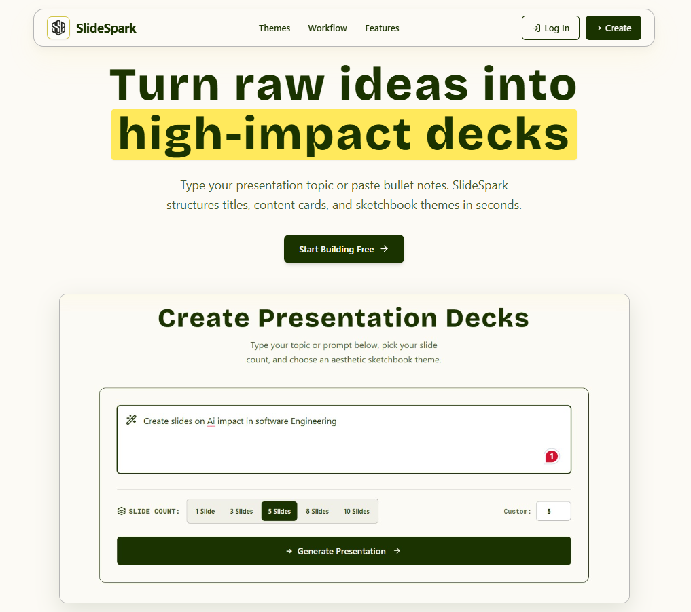

# SlideSpark — AI Presentation & Slide Deck Builder


**SlideSpark** is a full-stack, AI-powered presentation builder inspired by Gamma.ai. Turn a raw topic prompt or outline into a structured 16:9 slide deck with **7 Zod-validated adaptive layouts**, **8 editorial themes**, **textless AI editorial imagery**, and **native `.pptx` / PDF export**.



---

## Key Features

- **Structured Generative Engine (Zod Discriminated Unions):** Converts any prompt or outline into 1–20 slides via OpenRouter, validating every generated slide against a strict `SlideLayoutSchema` (`zod`) discriminated union across **7 adaptive layouts**:
  - `intro` · `title_bullets` · `stat_grid` · `quote` · `image_text` · `process_steps` · `comparison`
- **8 Editorial Themes with Custom SVG Overlays:** Switch live between *Cream Sketchbook*, *Forest Ink*, *Mint Botanical*, *Terracotta Studio*, *Teal Blueprint*, *Blush Note*, *Obsidian Editorial*, and *Navy Blueprint* — each mapped to synchronized PPTX color palettes.
- **Textless AI Visual Generation:** Generate photorealistic, text-free commercial photography per slide via OpenRouter image models with authenticated ownership checks and local asset persistence.
- **Native PPTX & Landscape PDF Export:**
  - Export decks to editable PowerPoint (`.pptx`) files using `pptxgenjs` preserving theme colors and layout structure.
  - Print-ready landscape PDF export powered by dedicated `@media print` stylesheets.
- **16:9 Slideshow Studio & Fullscreen Presenter:** Filmstrip thumbnail navigation, keyboard controls, and fullscreen presentation mode.
- **Authenticated Workspace Dashboard:** Secure email/password and GitHub OAuth sessions via **Better-Auth**, with PostgreSQL persistence through **Prisma 7** (`@prisma/adapter-pg`).

---

## Tech Stack

| Layer | Technology |
| :--- | :--- |
| **Framework** | Next.js 16 (App Router), React 19, TypeScript 5 |
| **Styling** | Tailwind CSS v4, custom editorial SVG overlays |
| **AI & Validation** | OpenRouter SDK (`@openrouter/sdk`), Zod v4 discriminated unions |
| **Database & ORM** | PostgreSQL, Prisma 7 (`@prisma/adapter-pg`, `pg`) |
| **Authentication** | Better-Auth (session-based auth + GitHub OAuth) |
| **Export** | `pptxgenjs` (native `.pptx`) + `@media print` (PDF) |
| **Deployment** | Dockerized production build (`Dockerfile`) |

---

## Getting Started

### Prerequisites

- Node.js 20+ (or Bun)
- PostgreSQL database (Neon, Supabase, or local PostgreSQL)
- OpenRouter API key

### 1. Clone & Install

```bash
git clone https://github.com/M-U-Rony/ai-presentation-slide-builder.git
cd ai-presentation-slide-builder
npm install
```

### 2. Configure Environment Variables

```bash
cp .env.example .env
```

Fill in `.env`:

```env
OPENROUTER_API_KEY=""
DATABASE_URL=""
BETTER_AUTH_SECRET=""
BETTER_AUTH_URL="http://localhost:3000"
GITHUB_CLIENT_ID=""
GITHUB_CLIENT_SECRET=""
Text_Generation_Model=""
Image_Generation_Model=""
```

### 3. Push Database Schema

```bash
npx prisma db push
```

### 4. Run Development Server

```bash
npm run dev
# or: bun dev
```

Visit [http://localhost:3000](http://localhost:3000).

---

## Docker Deployment

```bash
docker build -t slidespark .
docker run -d -p 3000:3000 --name slidespark-app --env-file .env slidespark
```

---

## Project Structure

```text
├── app/
│   ├── api/
│   │   ├── auth/[...all]/          # Better-Auth endpoints
│   │   ├── generateSlides/         # OpenRouter structured slide deck generation
│   │   ├── generateImg/            # Authenticated AI slide artwork generation
│   │   ├── getPresentation/        # Single deck fetch
│   │   └── getUserPresentations/   # User deck history
│   ├── create/                     # Interactive prompt & theme builder
│   ├── dashboard/                  # Saved presentation workspace
│   ├── slides/                     # 16:9 studio viewer & fullscreen presenter
│   └── page.tsx                    # Landing page
├── components/
│   ├── slide-layouts/              # 7 adaptive layout renderers
│   ├── slide-themes/               # 8 editorial SVG theme overlays
│   ├── landing.tsx                 # Landing hero & showcase
│   ├── promtpage.tsx               # Prompt & slide-count controls
│   └── slidecard.tsx               # 16:9 slide canvas & filmstrip card
├── lib/
│   ├── slideLayouts.ts             # Zod discriminated union schemas for all 7 layouts
│   ├── pptxExport.ts               # Native .pptx deck exporter (pptxgenjs)
│   ├── theme.ts                    # 8 editorial themes + PPTX color tokens
│   ├── auth.ts / auth-client.ts    # Better-Auth server & client setup
│   └── prisma.ts                   # Prisma 7 pg-adapter singleton
├── prisma/
│   └── schema.prisma               # User, Session, Account, Presentation, Slide models
└── Dockerfile
```

---

## License

This project is open-source and available under the [MIT License](LICENSE).
